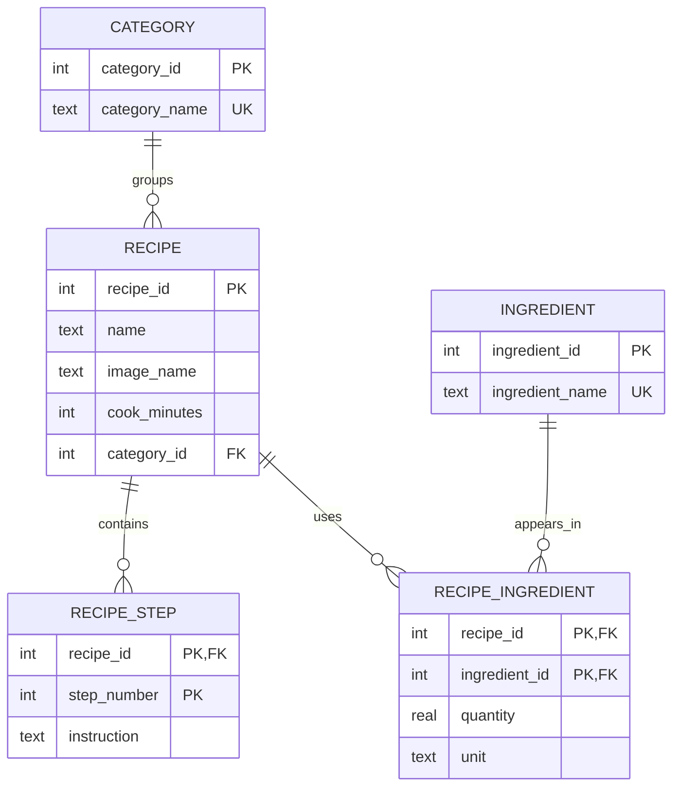

# ChefMate Project Check-In 3

**Umair Altaf**  
Fall 2026

## 1. Database integration

ChefMate uses the five tables designed in Check-in 2. The Android screens call the local data access API in `RecipeStore.kt`. It uses Android's `SQLiteOpenHelper` to open the database, enable foreign keys, and import the bundled data when the database is created. The home screen reads recipe cards from SQLite. Tapping a card passes its recipe ID to the detail screen, which reads instructions in step-number order and joins ingredients to their quantities. Search and the maximum cooking time filter use bound SQL parameters.

The seed contains 14 recipes and 78 instruction rows. Fried Salmon Steak and Butter Chicken keep the illustrative ingredient quantities from Check-in 2. The remaining seed recipes have no measured ingredients listed. New recipes are saved under Uncategorized with their numbered steps.

## 2. Entity relationship diagram



Each recipe has one category. Steps and ingredient links use composite keys. A valid submission through the Add recipe form includes at least one instruction.

## 3. Front-end validation

The Add recipe form checks for a nonblank name, positive whole-number cooking time, and at least one nonblank instruction before calling SQLite. A rejected input keeps the dialog open and shows an error on the relevant field. The search screen also checks the time filter before running the query. The database enforces keys and value constraints, and the save operation uses a transaction so a recipe and its steps are saved together.

## 4. Test cases and demo sequence

Record these cases in order on an Android emulator or phone. Start with a fresh app install. Record the observed results at the same time.

| Case | Action | Expected result | Verification status |
|---|---|---|---|
| T1 | Launch the app and advance to Home. | 14 imported recipe cards. | Seed verified in SQLite. Android run pending. |
| T2 | Open Butter Chicken. | 50 minutes, six ordered steps, and sample amounts of 1 tsp salt and 500 g chicken. | Rows verified in SQLite. Android run pending. |
| T3 | In Search, enter `butter chicken` and then `zzznomatch`. | Butter Chicken appears first. The second search shows an empty state. | SQL verified. Android run pending. |
| T4 | Clear the search and set the maximum time to 30. | Includes Classic Margherita Pizza at 30. Excludes Butter Chicken at 50 and Traditional Irish Stew at 110. | SQL verified. Android run pending. |
| T5 | Open Add recipe and try saving with a blank title. Then set a title and enter 0 minutes. Finally enter 12 minutes and leave instructions blank. | Each invalid attempt displays a field error and keeps the form open. | Android run pending. |
| T6 | In the same form, use the title Demo Toast, 12 minutes, and two lines of instructions. Save, reopen the app, search for Demo Toast, and open it. | The saved recipe persists with both instructions in order. | Android run pending. |

## 5. SQL troubleshooting

The old Kotlin model stored cooking time as display text such as `110 minutes`. I reproduced a filtering problem with that representation by running the following query against the seed data:

```sql
SELECT name FROM Recipe
WHERE printf('%d minutes', cook_minutes) <= '30 minutes';
```

The query incorrectly includes Traditional Irish Stew because the strings compare alphabetically and the first character of `110 minutes` is less than the first character of `30 minutes`. Running the query directly exposed the incorrect row before investigating the UI. The app stores whole-number minutes, filters with `cook_minutes <= CAST(? AS INTEGER)`, and formats the label only when showing the recipe. With the bound value 30, the corrected query includes recipes taking exactly 30 minutes and excludes the 110-minute stew.

The reproduction and corrected result can be checked with `python3 docs/verify_checkin3.py`. This is a direct SQLite reproduction using ChefMate data. Android runtime verification and the recorded demo are pending.
